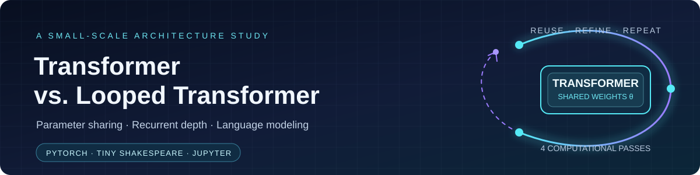
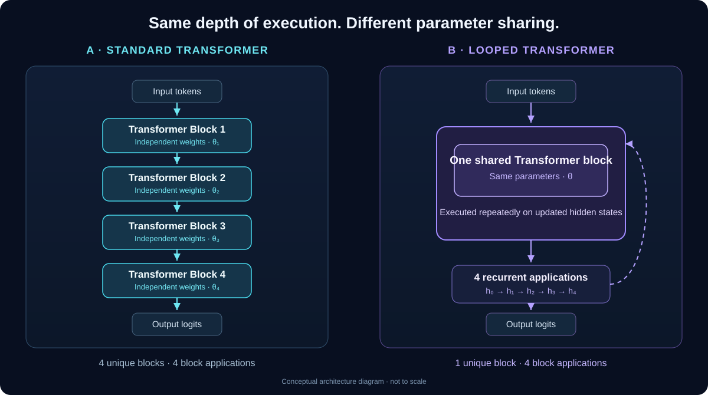
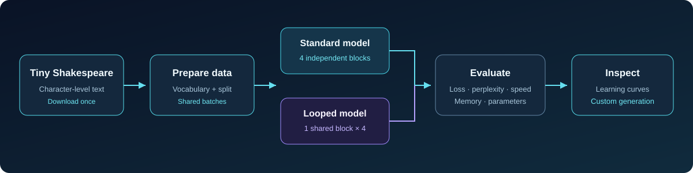

<div align="center">



### One computation path. Two ways to learn its transformations.

**A hands-on PyTorch study of standard and weight-shared Transformers, trained on Tiny Shakespeare.**

<a href="https://img.shields.io/badge/PyTorch-2.9.1%2BCUDA%2012.8-ee4c2c?style=for-the-badge&logo=pytorch&logoColor=white"></a>
<a href="https://img.shields.io/badge/Python-3.12-0b2037?style=for-the-badge&logo=python&logoColor=55e9f5"></a>
<a href="https://img.shields.io/badge/Jupyter-Notebook-f37726?style=for-the-badge&logo=jupyter&logoColor=white"></a>
<a href="https://img.shields.io/badge/Task-Character%20Language%20Modeling-174056?style=for-the-badge"></a>

[**Open the complete notebook**](standard_vs_looped_transformer_experiment.ipynb) &nbsp;·&nbsp;
[Experiment design](#02--the-experiment) &nbsp;·&nbsp;
[Run locally](#04--run-the-experiment) &nbsp;·&nbsp;
[Generate text](#06--try-your-own-prompts)

<sub>Educational experiment · PyTorch · Jupyter · Reproducible configuration</sub>

</div>

---

### `01 // THE QUESTION`

Can a Transformer reuse the same learned block multiple times, instead of learning a different set of weights at every depth?

This repository makes that idea concrete with two small causal language models. Both process the same character-level text task and apply a Transformer block **four times per forward pass**. The difference is how many unique sets of block parameters they learn.

- **Standard Transformer:** four independently parameterized blocks.
- **Looped Transformer:** one Transformer block, reused four times. Each pass receives the hidden representation produced by the previous pass.

This is a learning experiment about **parameter sharing and recurrent computation** — not a claim that looping always improves model quality.

### `02 // THE EXPERIMENT`

<div align="center">

</div>

#### At a glance

<table>
<tr>
<td width="25%" align="center"><strong>4</strong><br><sub>Block applications<br>per forward pass</sub></td>
<td width="25%" align="center"><strong>4 → 1</strong><br><sub>Unique Transformer blocks<br>standard → looped</sub></td>
<td width="25%" align="center"><strong>128</strong><br><sub>Hidden dimension</sub></td>
<td width="25%" align="center"><strong>1,200</strong><br><sub>Optimizer updates<br>per model by default</sub></td>
</tr>
</table>

| Setting | Standard | Looped |
| :--- | :--- | :--- |
| Unique Transformer blocks | 4 | 1 |
| Block applications per forward pass | 4 | 4 |
| Hidden dimension | 128 | 128 |
| Attention heads | 4 | 4 |
| Context length | 128 characters | 128 characters |
| Batch size | 32 | 32 |
| Optimizer updates | 1,200 | 1,200 |
| Dataset, tokenizer and split | Shared | Shared |

**Important fairness note:** This is a same-training-setup / same-block-application comparison, **not a parameter-matched experiment**. The standard model has four independently learned blocks; the looped model shares one block's weights. Consequently, their trainable parameter counts differ. The notebook measures those counts rather than assuming that fewer parameters means better efficiency or better quality.

### `03 // WHAT THE NOTEBOOK MEASURES`

<div align="center">

</div>

After both models train, the notebook produces:

| Metric / view | What it helps answer |
| :--- | :--- |
| Training and validation loss curves | How quickly does each model fit the training data, and how well does it generalize? |
| Final validation loss and perplexity | Which model predicts held-out characters more effectively? |
| Trainable parameter count | How much learned parameter storage does each architecture require? |
| Training time and throughput | What is the wall-clock cost on this hardware? |
| Forward latency and generation speed | How does recurrent reuse affect inference? |
| Peak CUDA memory (when available) | What GPU memory was allocated during training? |
| Generated text | What do the learned character-level distributions look like? |

The notebook generates the plots from **your actual run**. No benchmark scores or loss curves are hard-coded into this README.

### `04 // RUN THE EXPERIMENT`

#### Requirements

- Python 3.12.
- Dependencies pinned in `requirements.txt` (including PyTorch 2.9.1 with CUDA 12.8).
- An NVIDIA GPU is recommended for faster training. The notebook also has CPU and Apple Silicon MPS device-selection paths.
- Internet access on the first run to download Tiny Shakespeare.

#### 1. Clone the repository

```bash
git clone https://github.com/ANASS19/Transformer-vs-Looped-Transformers.git
cd Transformer-vs-Looped-Transformers
```

#### 2. Create an environment and install dependencies

**Windows PowerShell**

```powershell
py -3.12 -m venv .venv
.\.venv\Scripts\Activate.ps1
python -m pip install --upgrade pip
python -m pip install -r requirements.txt
```

**Linux**

```bash
python3.12 -m venv .venv
source .venv/bin/activate
python -m pip install --upgrade pip
python -m pip install -r requirements.txt
```

The supplied requirements file installs the CUDA 12.8 PyTorch wheel. For macOS / Apple Silicon, install the suitable PyTorch build from the [official PyTorch selector](https://pytorch.org/get-started/locally/) and install the remaining packages listed in `requirements.txt`.

#### 3. Launch Jupyter

```bash
python -m jupyter lab
```

Open **`standard_vs_looped_transformer_experiment.ipynb`**, select the environment's Python kernel, and run the cells from top to bottom.

<sub>On CPU, reduce `MAX_ITERS`, `BATCH_SIZE`, or `D_MODEL` in the configuration cell for a quicker first run. The default experiment uses 1,200 optimizer updates per architecture.</sub>

### `05 // NOTEBOOK WALKTHROUGH`

The complete comparison notebook is the main entry point:

| Section | What happens |
| :--- | :--- |
| Setup and data | Reproducibility, device selection, dataset download, character vocabulary and train/validation split |
| Shared components | Causal self-attention, feed-forward network and Transformer block |
| Model A | Build the conventional Transformer with four independent blocks |
| Model B | Build one shared block and apply it four times |
| Training | Train both models with the same optimizer setup and reproducible batch stream |
| Evaluation | Track train/validation loss, perplexity, parameter count, memory and runtime |
| Visual analysis | Plot learning curves and a side-by-side metric dashboard |
| Text generation | Compare both models on the same prompt; edit prompts and sampling settings |
| Artifacts | Save histories, metric summaries and checkpoints under `results/` |

The repository also retains the two focused notebooks — `standard_transformer_experiment.ipynb` and `looped_transformer_experiment.ipynb` — as standalone architecture walkthroughs. For the full side-by-side experiment, start with the combined notebook.

### `06 // TRY YOUR OWN PROMPTS`

After training, use the prompt cells or the optional interactive controls inside the notebook.

Try prompts such as:

- `ROMEO:`
- `JULIET:`
- `To be, or not to be,`
- `KING:`
- Your own sentence

You can change:

- **Model:** standard, looped, or both.
- **Prompt:** any text; Shakespeare-style prompts are most aligned with the training corpus.
- **New characters:** how long the continuation should be.
- **Temperature:** lower values usually make sampling more conservative; higher values increase variety.
- **Top-k:** restrict sampling to the highest-scoring next-character candidates.
- **Seed:** use the same seed to make comparisons more reproducible.

This is a **character-level continuation model**, not an instruction-following chatbot. It learns to continue patterns in the training text.

### `07 // OUTPUTS & PROJECT STRUCTURE`

Running the notebook creates a local `results/` directory:

```text
results/
├── standard_history.csv
├── looped_history.csv
├── standard_metrics.json
├── looped_metrics.json
├── comparison_metrics.csv
├── standard_model.pt
└── looped_model.pt
```

The generated checkpoints and run-specific metrics are ignored by Git so that the repository stays lightweight. Keep them locally when you want to compare multiple runs.

```text
.
├── assets/
│   ├── banner.svg
│   ├── architecture-comparison.svg
│   └── experiment-pipeline.svg
├── standard_vs_looped_transformer_experiment.ipynb   # main entry point
├── standard_transformer_experiment.ipynb              # standalone walkthrough
├── looped_transformer_experiment.ipynb                # standalone walkthrough
├── requirements.txt
├── .gitignore
└── README.md
```

### `08 // INTERPRETING THE RESULTS`

Use the measurements from your own run. A lower validation loss is better for next-character prediction, while parameter count, training time, latency and memory describe different efficiency dimensions.

A useful interpretation should consider all of them:

1. Does the looped model achieve similar validation quality with fewer unique parameters?
2. Does the standard model use its additional independent weights to improve held-out predictions?
3. How does parameter sharing affect training speed and inference latency on the same hardware?
4. Do the generated continuations show qualitative differences that agree with the measured metrics?

Do not treat one seed or one small corpus as conclusive evidence. Results can vary with initialization, hardware, optimizer settings, dataset split and training duration. For stronger conclusions, repeat the comparison across multiple seeds and add parameter-matched and compute-matched baselines.

### `09 // NEXT EXPERIMENTS`

Ideas to extend this study:

- Repeat both runs across multiple random seeds and report mean and standard deviation.
- Compare models under matched parameter budgets.
- Sweep recurrent iterations and hidden dimensions.
- Add a model with loop-specific adapters or normalization.
- Test adaptive computation / learned halting.
- Evaluate on a larger dataset and a token-level language-modeling task.

---

<div align="center">

### Build, measure, understand.

**A small experiment for learning how Transformer computation can be organized.**

[**Open the notebook →**](standard_vs_looped_transformer_experiment.ipynb) &nbsp;·&nbsp;
[**View the source on GitHub →**](https://github.com/ANASS19/Transformer-vs-Looped-Transformers)

<sub>Created by Anass Nassiri · AI / ML engineering experiments</sub>

</div>
